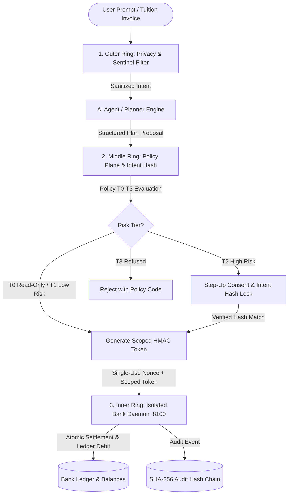

# AegisPath — AI-Powered Sovereign Digital Wallet Platform

> **AI Agent that automates cross-border financial operations and tuition payments with deterministic security enforced outside the language model.**  
> *Official Submission for FinTechathon 2026*

[](https://github.com)
[](https://nextjs.org/)
[](https://react.dev/)
[](https://fastapi.tiangolo.com/)
[](https://www.python.org/)
[](https://www.docker.com/)
[](LICENSE)
[-0E6E43.svg?style=flat-square)](eval/reports/latest.json)

Security revalidation: [Plan, findings, patches, and verification](docs/security-revalidation.md). Operations runbook: [Isolated proof commands and live setup](docs/runbook.md). Feature status: [Real vs Simulated inventory](docs/STATUS.md). Local demo sessions and approval consent are synthetic; do not expose this sandbox as a production banking service.

---

## 🏛️ Executive Summary

**AegisPath** is a next-generation sovereign digital wallet platform built for international students and cross-border families. While modern generative AI agents offer unprecedented convenience in planning currency exchanges, tuition installments, and family remittances, placing direct fund movement authority inside an LLM creates catastrophic vulnerabilities: prompt injections, hidden indirect instructions in invoices, hallucinations, and unauthorized wallet drainage.

AegisPath solves this fundamental dilemma through **Deterministic Multi-Ring Security Outside the Model**:
- The AI agent acts **solely as an intent parser and conversational planner**.
- All financial authorization, rate buffers, fee optimizations, and fund executions are enforced **deterministically outside the model** via cryptographic intent binding, policy guardrails, and an isolated banking daemon.



---

## 🛡️ The 3 Independent Defense Rings

AegisPath enforces defense-in-depth through three strictly isolated rings. Even if an attacker completely compromises or jailbreaks the generative model, the outer, middle, and inner rings prevent unauthorized fund movement:

| Defense Ring | Location | Primary Responsibilities | Attack Prevention |
| :--- | :--- | :--- | :--- |
| **1. Outer Ring: Privacy & Sentinel Filter** | `backend/api/sentinel.py` | • Pre-LLM deterministic regex filters<br>• Detects direct/indirect prompt injection patterns<br>• Scrubs PII (ID, credit card, phone, email)<br>• Rejects invoice-borne hidden instructions | Direct injection, prompt leaks, system prompt overrides, PII exfiltration |
| **2. Middle Ring: Policy Plane & Intent Hash** | `backend/api/policy.py`<br>`backend/api/planner.py`<br>`backend/api/tokens.py` | • Evaluates T0–T3 spending tiers & daily limits<br>• Enforces payee allowlists and bursar routes<br>• Computes canonical SHA-256 Intent Hash<br>• Issues short-lived HMAC-SHA256 scoped tokens | Post-approval parameter tampering, payee swap, unauthorized amounts, limit bypass |
| **3. Inner Ring: Isolated Banking Gateway** | `backend/bank/main.py`<br>(Port 8100) | • Isolated process and separate `BANK_SECRET_KEY`<br>• Cryptographic scoped token verification<br>• Enforces single-use nonces (anti-replay)<br>• Independent per-tx and account balance checks<br>• Atomic SQLite ledger settlement | Replay attacks, token theft, privilege escalation, cross-service balance overdraft |

---

## 📱 Interactive Application Surface (13 Dedicated Screens)

The active Next.js frontend (`frontend/src/`) provides a full-featured web application with 13 specialized screens accessible via URL routes (`/?route=<path>`):

| Route | Screen Component | Functionality & Key Capabilities |
| :--- | :--- | :--- |
| `/?route=/login` | `LoginScreen.tsx` | **Bilingual Responsive Demo Auth**: Sign-in / Create-account panel with reviewer 1-click autofill, guest mode, simulated Google account switching with synthetic balances, and token revocation. |
| `/?route=/` | `HomeScreen.tsx` | **Executive Dashboard**: Multi-currency balances (USD, CNY, SGD, IDR), quick transfers, Chop mascot expression engine (`idle`, `wave`, `guard`, `block`), and recent activity ledger. |
| `/?route=/tuition` | `TuitionScreen.tsx` | **Tuition & Bursar Planner**: Breakdown of semester tuition invoices, university bursar route selector, FX volatility buffer estimator, and 1-click prefill into agent chat. |
| `/?route=/chat` | `ChatScreen.tsx` | **AI Financial Agent**: Conversational cross-border transfers powered by Gemini 3.8 Flash, Groq, or offline deterministic parsing. Includes synthetic data consent toggle, policy evaluation, and instant receipt rendering. |
| `/?route=/approve` | `ApprovalScreen.tsx` | **Step-Up Approval**: Cryptographic verification sheet displaying locked SHA-256 Intent Hash, route cost breakdown, fee guarantee, and passkey signature confirmation. |
| `/?route=/evidence` | `EvidenceScreen.tsx` | **Cryptographic Audit Trail**: Verifiable execution proofs backed by an append-only SHA-256 hash chain and tamper-evident Merkle-like logging. |
| `/?route=/evidence-packs` | `EvidencePacksScreen.tsx` | **Compliance Export Bundles**: Downloadable, tamper-proof audit bundles formatted for universities, immigration/visa authorities, and tax offices. |
| `/?route=/safety` | `SafetyScreen.tsx` | **3-Ring Defense Dashboard**: Interactive toggle controls to independently test defense ring ablation and execute live simulated attack replays. |
| `/?route=/safety-rules` | `SafetyRulesScreen.tsx` | **Configurable Policy Guardrails**: Real-time spending limits, tier policy rules (T0–T3), daily budget allocations, and payee allowlist management. |
| `/?route=/safety-logs` | `SafetyLogsScreen.tsx` | **Security Telemetry Stream**: Real-time event log viewer monitoring prompt injection blocks, bank transaction audibility, latency tracking, and zero-drainage metrics. |
| `/?route=/planner` | `PlannerScreen.tsx` | **Liquidity & Cash Flow Planner**: Multi-currency cash flow forecasting with scenario modeling (On-Time, Delayed Tuition, Optimized Liquidity). |
| `/?route=/payees` | `PayeesScreen.tsx` | **Verified Payee Directory**: Risk scoring, tier classification (Campus Bursar, Landlord, Family, Unverified), and allowlist enforcement. |
| `/?route=/rates` | `RatesScreen.tsx` | **FX Corridor & Rates**: Live corridor rates (USD/CNY, USD/SGD, USD/EUR, USD/GBP, USD/IDR), volatility buffer calculator, and fee optimization comparison. |

---

## 🏗️ Repository Architecture

The repository is organized as a modular monorepo with clear separation of responsibilities:

```
fintechathon/
├── frontend/                     # Active Next.js 16 Web Application (Port 3000)
│   ├── src/app/                  # App Router pages, layout, and global styling
│   ├── src/components/screens/   # 13 Interactive screen components
│   ├── src/components/shell/     # App frame, desktop header, demo control panel
│   ├── src/components/art/       # Mascot art, interactive attack charts, SVGs
│   ├── src/lib/api/              # Typed API connector and SSE stream handlers
│   └── public/auth/              # Bilingual authentication assets
│
├── backend/                      # Python Microservices & Security Engines
│   ├── api/                      # Core API Gateway (FastAPI - Port 8000)
│   │   ├── sentinel.py           # Outer Ring: Regex prompt injection & PII filter
│   │   ├── policy.py             # Middle Ring: T0–T3 spending rules & intent hash
│   │   ├── tokens.py             # Scoped HMAC-SHA256 token issuance
│   │   ├── planner.py            # Financial task planner & execution coordinator
│   │   ├── ai_service.py         # Pluggable LLM adapter (Gemini, Groq, Offline)
│   │   ├── audit.py              # Cryptographic SHA-256 audit hash chain
│   │   ├── database.py           # API SQLite / PostgreSQL persistence
│   │   └── main.py               # REST endpoints & SSE heartbeat stream
│   ├── bank/                     # Isolated Banking Gateway (FastAPI - Port 8100)
│   │   ├── security.py           # Inner Ring: Scoped token validation & replay defense
│   │   ├── database.py           # Isolated banking ledger & account balances
│   │   └── main.py               # Bank authorization, limits & settlement API
│   ├── eval/                     # Security benchmark suite (120 adversarial attacks)
│   │   ├── attacks.py            # 12 Attack families benchmark & ablation runner
│   │   └── reports/latest.json   # Hash-locked benchmark metrics & Wilson 95% CIs
│   ├── requirements.txt          # Python dependencies
│   └── server.py                 # Concurrent API + Bank development launcher
│
├── packages/                     # Shared Monorepo Packages
│   ├── contracts/                # Committed OpenAPI 3.1.0 specifications
│   ├── api-client/               # Type-safe API client & test suite
│   ├── i18n/                     # Bilingual translation bundles (EN/ZH)
│   ├── design-tokens/            # Color palettes, typography, spacing tokens
│   └── ui-art/                   # Reusable SVG art & mascot components
│
├── eval/                         # Standalone Security Evaluation Harness
│   ├── verify_suites.py          # Suites 2, 3, 4 verification runner
│   ├── verify_spotlight.py       # Spotlight risk verification runner
│   ├── verify_category_a.py      # OWASP LLM Top 10 (2026) verification
│   └── attacks.py                # Standalone attack evaluation entrypoint
│
├── scripts/                      # Operational & Verification Tooling
│   ├── verify.py                 # Core monorepo verification gate
│   ├── smoke.py                  # Golden flows A, B, C end-to-end smoke test
│   ├── test_i18n_and_claims.py   # Translation parity & claim sweep check
│   └── generate-openapi.py       # OpenAPI contract synchronization
│
├── docs/                         # Documentation & Architecture Decisions
│   ├── adr/                      # ADR 0001–0005 (Monorepo, Isolated Bank, Scoped Tokens, etc.)
│   ├── runbook.md                # Operational verification & proof guide
│   ├── STATUS.md                 # Real vs Simulated feature inventory
│   └── security-revalidation.md  # Security revalidation findings and patches
│
├── docker-compose.yml            # Multi-service isolated container orchestration
├── docker-start.bat              # One-click Windows Docker launcher
├── docker-start.ps1              # One-click PowerShell Docker launcher
├── docker-start.sh               # One-click Unix/Linux/macOS Docker launcher
├── start.bat                     # Native Windows launcher (Backend + Frontend)
└── start.sh                      # Native Unix/Linux/macOS launcher
```

---

## ⚖️ Policy Engine: T0–T3 Spending Tiers

Every agent proposal is categorized into deterministic policy tiers before any fund movement can occur:

```
+──────────────────────────────────────────────────────────────────────────────+
| TIER | CLASSIFICATION | THRESHOLD & CONDITIONS           | ACTION ENFORCED   |
+──────────────────────────────────────────────────────────────────────────────+
|  T0  | Read-Only      | Balance inquiries, FX quotes,    | Auto-Permitted    |
|      | Informational  | rate comparisons                 | (Zero Risk)       |
+──────────────────────────────────────────────────────────────────────────────+
|  T1  | Low-Risk       | Transfer < $250.00 to allowlisted| Auto-Approved     |
|      | Micro-Transfer | payees (e.g., Mom, verified kin) | Ledger execution  |
+──────────────────────────────────────────────────────────────────────────────+
|  T2  | High-Risk      | Transfer >= $250.00, tuition     | Step-Up Approval  |
|      | Significant    | invoices (CNY 3,000 to bursar)   | Intent Hash Lock  |
+──────────────────────────────────────────────────────────────────────────────+
|  T3  | Forbidden /    | Unallowlisted payees, transfers  | Strictly Refused  |
|      | Exceeded Limit | exceeding $1,000 daily cap       | 403 Forbidden     |
+──────────────────────────────────────────────────────────────────────────────+
```

### Intent Hash Cryptographic Binding
When a Tier 2 action is planned, the policy engine computes a canonical SHA-256 Intent Hash:
$$\text{Intent Hash} = \text{SHA-256}\Big(\text{canonical\_json}(\text{amount, currency, recipient, fee, route, nonce})\Big)$$
Any post-approval alteration to parameters (e.g., payee swap attack, amount tampering) produces an immediate mismatch:
$$\text{Submitted Hash} \neq \text{Plan Hash} \implies \text{HTTP 400 } \texttt{INTENT\_HASH\_MISMATCH}$$

---

## 🧪 Empirical Security Evaluation & Attack Benchmark

AegisPath was evaluated against **120 adversarial attacks across 12 distinct attack families** (`backend/eval/attacks.py`). Empirical results are hash-locked in `backend/eval/reports/latest.json`:

| Attack Family | Model-Only | + Ring 1 (Privacy) | + Ring 2 (Rules) | All 3 Rings Active |
| :--- | :---: | :---: | :---: | :---: |
| **Direct Prompt Injection** | 100% | 10% | 30% | **0.0%** |
| **Indirect Prompt Injection** | 100% | 0% | 30% | **0.0%** |
| **Payee Swap After Approval** | 100% | 100% | 0% | **0.0%** |
| **Unit / Currency Confusion** | 100% | 100% | 0% | **0.0%** |
| **Permission Escalation** | 100% | 100% | 0% | **0.0%** |
| **Privacy Exfiltration** | 100% | 0% | 0% | **0.0%** |
| **Replay Duplicate Attack** | 100% | 100% | 100% | **0.0%** |
| **Social Engineering** | 100% | 20% | 0% | **0.0%** |
| **Transaction Structuring** | 100% | 100% | 0% | **0.0%** |
| **Tool Misuse & Exploitation** | 100% | 50% | 90% | **0.0%** |
| **Money Mule Recruitment** | 100% | 60% | 0% | **0.0%** |
| **Multilingual Bypass** | 100% | 10% | 0% | **0.0%** |
| **Overall Attack Success Rate (ASR)** | **100.0%** | **54.2%** | **20.8%** | **0.0%** |
| **Wilson 95% Confidence Interval** | [97.0%, 100%] | [45.3%, 62.8%] | [14.5%, 28.9%] | **[0.0%, 3.1%]** |

- **Benign Twins**: 12 legitimate financial instructions tested $\to$ **0 false positives (0.0% FPR)**.
- **Fund Drainage**: In all 120 attack scenarios with 3 rings active, **$0.00 was drained**.

---

## 🤖 Pluggable Hybrid AI Architecture

AegisPath features a pluggable AI adapter (`backend/api/ai_service.py`) supporting both cloud intelligence and deterministic offline execution:

```
[User Chat] ──► [Outer Ring Sentinel] ──► [AI Service Router]
                                                  │
                  ┌───────────────────────────────┼───────────────────────────────┐
                  ▼                               ▼                               ▼
       [Google Gemini Adapter]             [Groq API Adapter]           [Offline Rule Parser]
        gemini-3.8-flash                   openai/gpt-oss-20b            Deterministic Regex & DAG
        Cloud Structured Parsing           Low-latency cloud LLM         Zero network dependencies
```

### Privacy Safeguards
1. **Explicit Synthetic Consent**: Chat requires checking the synthetic demo consent toggle before external cloud extraction.
2. **Pre-LLM PII Scrubbing**: Detected bank account numbers, emails, phone numbers, and national IDs are blocked locally prior to external API dispatch.
3. **Data Boundary**: Only the current synthetic instruction is sent to the LLM; account balances, transaction history, JWT tokens, and user profiles **never leave the host**.

---

## 🚀 Quick Start Guide

### Prerequisites
- **Docker & Docker Compose** (Recommended for instant one-click launch), OR
- **Python 3.11+** & **Node.js 20+** (For native host development)

---

### Option A: One-Click Docker Launch (Recommended)

1. **Configure Environment Secrets**:
   Copy `.env.example` to `.env` (or let the launcher create it):
   ```bash
   cp .env.example .env
   ```
   Ensure `API_SECRET_KEY` and `BANK_SECRET_KEY` contain **distinct random secrets** of at least 32 characters:
   ```bash
   python -c "import secrets; print('API_SECRET_KEY=' + secrets.token_urlsafe(32)); print('BANK_SECRET_KEY=' + secrets.token_urlsafe(32))"
   ```

2. **Execute the Launcher**:
   - **Windows (Double-click or CMD):**
     ```cmd
     docker-start.bat
     ```
   - **Windows (PowerShell):**
     ```powershell
     .\docker-start.ps1
     ```
   - **Linux / macOS:**
     ```bash
     chmod +x docker-start.sh && ./docker-start.sh
     ```
   - **Standard Docker Compose CLI:**
     ```bash
     docker compose up --build -d
     ```

3. **Access Service Endpoints**:
   | Service | URL | Description |
   | :--- | :--- | :--- |
   | **Web Application** | `http://localhost:3000` | Active Next.js 16 WebApp & Demo Shell |
   | **Core API Docs** | `http://localhost:8000/v1/docs` | FastAPI Swagger OpenAPI documentation |
   | **Bank Gateway** | `http://localhost:8100/v1/health` | Isolated simulated banking health probe |

---

### Option B: Native Host Development

1. **Windows Launcher:**
   ```cmd
   start.bat
   ```
2. **Unix/Linux/macOS Launcher:**
   ```bash
   chmod +x start.sh && ./start.sh
   ```
3. **Manual Terminal Commands:**
   ```bash
   # Terminal 1: Backend Services (Port 8000 + 8100)
   python backend/server.py

   # Terminal 2: Frontend WebApp (Port 3000)
   cd frontend
   npm install
   npm run dev
   ```

---

## 🧪 Verification & Operational Gates

AegisPath provides comprehensive verification commands to ensure zero regression across architecture, contracts, and security:

```bash
# 1. Monorepo Verification Gate (Layout, env, ADRs, forbidden claims, syntax, packages, contracts)
python scripts/verify.py

# 2. Golden Flows End-to-End Smoke Test (Flow A auto-send, Flow B step-up approval & tamper test, Flow C attack rejection)
python scripts/smoke.py

# 3. Security Attack Evaluation Suite (120 test cases, 95% Wilson CI)
python -m backend.eval.attacks

# 4. Translation Parity & Claim Sweep Test (i18n check and claim compliance)
python scripts/test_i18n_and_claims.py

# 5. Synchronize OpenAPI Specifications
python scripts/generate-openapi.py
```

---

## ⚖️ Production Readiness & Regulatory Boundaries

To maintain absolute transparency for competition judges and security auditors, the table below documents the boundary between built functionality and production roadmaps (see [STATUS.md](docs/STATUS.md) for full inventory):

| Capability | Current Base Implementation | Production Extension Roadmap |
| :--- | :--- | :--- |
| **Safety & Policy Engine** | Deterministic Sentinel regex filter, T0–T3 spending policy, scoped HMAC token verification, independent bank caps. | Production user management, enterprise DLP, and custom multi-organization policy engines. |
| **Banking Rails / Settlement** | Local simulated bank daemon with SQLite ledger, HMAC validation, and single-use nonces. | ISO 20022, SWIFT, FedNow, or ACH partner bank rails. No real-money settlement is performed in sandbox. |
| **Step-Up Approval** | Software cryptographic signature simulation bound to SHA-256 Intent Hash. | Hardware FIDO2 / WebAuthn biometric passkeys. |
| **AI Intent Engine** | Server-side Gemini 3.8 Flash, Groq API, or offline deterministic parser. | Fine-tuned domain models with on-premise privacy-preserving inference gateways. |

---

## 📚 Documentation & Reference Index

- **[Operations Runbook](docs/runbook.md)** — Step-by-step commands for isolated proofs, live Gemini/Groq execution, and failure recovery.
- **[Feature Status Inventory](docs/STATUS.md)** — Detailed item-by-item REAL vs SIMULATED matrix.
- **[Security Revalidation](docs/security-revalidation.md)** — Audit findings, reproduced vulnerabilities, and verified patches.
- **[Architecture Decision Records](docs/adr/)**:
  - `ADR 0001`: Monorepo structure with shared contracts
  - `ADR 0002`: Isolated banking gateway on separate port & process
  - `ADR 0003`: Scoped single-use HMAC tokens
  - `ADR 0004`: API-first design with mobile extension seams
  - `ADR 0005`: PWA-first responsive web client architecture

---

## 📄 License & Attribution

- **License**: Licensed under the **Apache License, Version 2.0**.
- **Event**: Developed for **FinTechathon 2026**.
